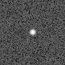
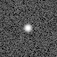
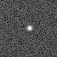
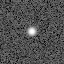
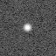

# Outputs

Each run saves its cutout images, the settings used to make them, and a JSON
record of what succeeded, failed or was skipped. The location is set by
`storage.output_directory` in your configuration.

## Folder layout

With the default output directory, the files are arranged like this:

```text
cutouts/                                  # storage.output_directory
├── runs/
│   └── bulge-field-test/                  # run.name (default: default)
│       ├── r0001/                        # First revision
│       │   ├── resolved-config.yaml
│       │   ├── manifest.json             # Status, current quality and file list
│       │   ├── cutouts/<target-id>/<cutout-id>/
│       │   │   ├── cutout.asdf            # If selected
│       │   │   └── cutout.fits            # If selected
│       │   ├── stacks/<target-id>/
│       │   │   ├── colour-composite.png   # If RGB is enabled
│       │   │   └── <filter>/
│       │   │       ├── preview-stack.fits
│       │   │       └── preview-animation.gif
│       │   └── stack-manifest.json       # Display inputs and exclusions
│       └── r0002/                        # Changed settings or inputs
├── .cache/                               # Verified reusable stage products
└── parents/                              # Only when full retention is enabled
    └── <parent-file-hash>/<original-filename>
```

Names in angle brackets are placeholders:

- **Run name** is the workspace name you choose in `run.name`.
- **Revision** (`r0001`, `r0002`, …) records one configuration and input set.
  Unchanged work resumes or returns the latest complete revision. Changed work
  creates a revision while reusing stages whose inputs still match. See
  [named runs and reuse](configuration.md#named-runs-revisions-and-reuse).
- **`target-id`** is the target name from your configuration or CSV.
- **`cutout-id`** identifies the particular input image, target and processing
  settings, including any selected WCS correction. Each input image can produce
  a separate cutout folder for the same target.
- **`filter`** is the exposure filter label, such as `F146`. Each target/filter
  group can have a separate display stack.
- **`parent-file-hash`** is a SHA-256 fingerprint of the input file's contents,
  used to distinguish full images even if their filenames match.

The tree shows one cutout and one optional stack; runs can contain many of each.
Only the formats you select are written. Stacks, GIFs and colour composites can be enabled independently. Each is absent when disabled or
when no eligible inputs are available. Hidden `.pipeline.lock` and `.cache` entries
support locking and temporary processing; they are not science outputs.

## Which file should I open?

| File | What it contains | When to use it |
| --- | --- | --- |
| `cutout.asdf` | Science pixels, uncertainties, quality flags, additional cropped arrays, coordinate model and metadata. | Read one cutout with its complete saved coordinate model and metadata. |
| `cutout.fits` | The same cutout in FITS image extensions, with complete metadata and the coordinate model embedded in an extra extension. | Open SCI/ERR/DQ in FITS software, or use the Gladius reader to recover all saved information. |
| `manifest.json` | Revision status, configuration, input identities, current quality, native file checksums, reuse counts, skips and errors. | Check whether the run succeeded and find its current outputs. |
| `resolved-config.yaml` | The run's settings, with defaults filled in and paths resolved. | Inspect or repeat the configuration used for this run. |
| `preview-stack.fits` | A median display image made from aligned cutouts, plus a count of contributing values at each pixel. | Visual inspection. **Use individual cutouts for scientific measurements.** |
| `colour-composite.png` | Three independently normalized filter medians assigned to red, green and blue on one shared sky grid. | Inspect a false-colour view. Colours are not calibrated source colour ratios. |
| `preview-animation.gif` | Individual exposures aligned to the reference sky grid, played in time order with a shared brightness stretch and timestamp labels. | Inspect changes between exposures; playback speed is configurable and does not represent observing cadence. |
| `stack-manifest.json` | Median stack, GIF and colour-composite paths, input membership, references, display settings, exclusions and composite skips. | Find display outputs and check which cutouts contributed to them. |
| `parents/<parent-file-hash>/<original-filename>` | A full copy of a selected input image. | Keep full detector images when `storage.retain_full_images` is enabled. Existing local originals are never deleted. |

### Finding output paths

There are two file lists:

- **`manifest.json` → `entries` → `files`** lists the native ASDF/FITS cutouts.
- **`stack-manifest.json` → `products`, `animations`, `composites`** lists median
  FITS stacks, exposure GIFs and RGB PNGs, respectively. This second manifest is
  written when display outputs are requested and that phase completes.

All listed paths are relative to the run directory containing the manifests.
For example, to find display outputs in Python:

```python
import json
from pathlib import Path

# Replace this with your run directory printed by Gladius.
run_directory = Path("cutouts/runs/<run-name>/<revision>")
display_manifest = run_directory / "stack-manifest.json"
if display_manifest.exists():
    outputs = json.loads(display_manifest.read_text())
    for kind in ("products", "animations", "composites"):
        for output in outputs.get(kind, []):
            print(kind, run_directory / output["path"])
```

Older files can remain after rerunning with changed inputs. Finding a file on
disk does not establish that it belongs to the current run. Check the overall
status in `manifest.json` too: a failed run can leave earlier display files, and
`stack-manifest.json` does not by itself establish that the latest attempt finished.

## Example images

This page uses **two different synthetic examples**. The parent images, cutouts,
median stack and exposure GIF below use the single-star `gladius demo` example.
The [colour composite](#colour-composites) uses a separate six-star, three-filter
field generated by the documentation script. Neither uses Roman observations.

For the single-star example, the exact command is:

```sh
gladius demo /tmp/gladius-single-star-demo
```

Choose a fresh destination. This creates two noisy 96 × 96 pixel parents in F146,
two 64 × 64 cutouts, a median FITS stack and an exposure GIF, plus the configuration
and run manifests. It does not create the six-star colour example.

Each parent shown below is 96 × 96 pixels. The gold outline
marks the 64 × 64 region copied into its cutout. Parents and cutouts use the same
pixel scale below, so you can see how much of the original image is retained.

```{raw} html
<div class="demo-image-grid">
<figure><figcaption>Parent image · exposure 1</figcaption><div class="demo-parent"><span class="demo-region" style="left:17.708333%;top:16.666667%;width:66.666667%;height:66.666667%" aria-hidden="true"></span></div></figure>
<figure><figcaption>Cutout · exposure 1</figcaption></figure>
<figure><figcaption>Parent image · exposure 2</figcaption><div class="demo-parent"><span class="demo-region" style="left:18.75%;top:16.666667%;width:66.666667%;height:66.666667%" aria-hidden="true"></span></div></figure>
<figure><figcaption>Cutout · exposure 2</figcaption></figure>
</div>
<figure class="demo-stack-image"><figcaption>Display stack · both exposures</figcaption></figure>
```

The same sky source appears 1.5 detector pixels farther across in the second
exposure because the simulated pointing changes. Gladius aligns the cutouts using
their sky coordinates, then takes the median to make the display stack. This is one combined image. The optional GIF below instead cycles through
the aligned individual exposures. Independent Gaussian noise has a standard deviation of 2 DN/s in each input.
Combining the exposures reduces the visible background noise. With just two
values, the median is their average; interpolation during alignment also smooths
the second exposure. **The stack is for visual
inspection; use individual cutouts for scientific measurements.**

All five previews use the same grayscale brightness stretch to reveal the source
and background. This changes only how the PNGs look; the ASDF and FITS outputs
keep their numerical pixel values. Both exposures contribute to almost all pixels; one edge
has only the reference exposure because the other cutout is offset by half a
pixel. Real shifts, rotations, detector edges or masked pixels can leave regions
with fewer contributing exposures. The FITS `COVERAGE` extension records that
count.

These simple images demonstrate extraction
and alignment, not the appearance or noise properties of real Roman data.

The five grayscale PNGs are documentation previews rendered from that demo's
image arrays. They are made by the documentation script described in the
[colour example instructions](#reproduce-the-colour-example); `gladius demo`
itself writes ASDF/FITS cutouts, a FITS stack and the GIF.

### Animated exposures

```{figure} _static/examples/demo-animation.gif
:alt: The two noisy synthetic exposures blinking in time order, aligned to the same sky grid.

The single-star `gladius demo /tmp/gladius-single-star-demo` exposures, shown for 500 ms each. The median stack above
combines these images; this animation keeps them separate.
```

Enable either or both outputs in the GUI under **Stacks, animations & colour**, or in YAML:

```yaml
stacks:
  enabled: true       # Single median FITS image
  gif_enabled: true   # Animation of individual aligned exposures
  gif_frame_ms: 500   # Playback time per exposure, in multiples of 10 ms
```

GIFs are grouped by target and filter. They use the same quality exclusions,
reference grid and exposure/memory limits as median stacks. Frames are ordered
by the input exposure start time; missing times appear last, with a label saying
the time is unavailable and a stable input-ID order. With one eligible exposure,
the GIF has just one frame.

All frames share a grayscale asinh stretch using the combined frames' 1st and
99.95th percentiles. Missing pixels are purple. Frame labels show exposure number
and UTC start time. The animation is a display preview: alignment interpolates
pixels, GIF brightness is quantized, and exposures are not matched to a common
photometric calibration or point-spread function. Apparent changes need checking
against the original cutouts.

`stack-manifest.json` records the animation path and checksum, frame input IDs,
UTC start times, playback duration and brightness limits under `animations`.

### Colour composites

```{figure} _static/examples/demo-colour-composite.png
:alt: Synthetic star field with red, blue, green and white sources in a three-filter composite.
:width: 320px
:class: pixel-preview

A separate six-star synthetic field generated by `tools/build_doc_examples.py`,
with two exposures in each of three filters.
R = F213, G = F184, B = F062. Source brightnesses were deliberately varied
between filters to demonstrate display colours; these are not Roman observations.
```

(reproduce-the-colour-example)=
#### Reproduce the colour example

Run these commands from the root of a Gladius source checkout:

```sh
python -m pip install -e '.'
python tools/build_doc_examples.py --output /tmp/gladius-doc-previews
```

This script generates **both** example fields and runs them through Gladius.
For the colour field it creates six stars with different brightnesses in F062,
F184 and F213, with two noisy, offset exposures per filter. It writes
`demo-colour-composite.png` to `/tmp/gladius-doc-previews`, alongside the single-star
parent/cutout PNGs, stack PNG and exposure GIF. Input ASDF files and intermediate
science outputs are created in temporary directories and removed when the script
finishes. Only the previews remain in the selected output directory.

There is currently no separate `gladius demo` subcommand for the six-star field.
The RGB settings below enable composites for your own multi-filter inputs; they
do not generate synthetic observations.

Enable **Create colour composites** under **Stacks, animations & colour**, or set:

```yaml
stacks:
  rgb_enabled: true
  red_filter: F213
  green_filter: F184
  blue_filter: F062
```

The three channel assignments are editable. Median stacks and GIFs can be enabled
alongside the composite, or disabled independently. RGB creation requires eligible
cutouts in all selected filters. A target missing a required filter is skipped
for the composite, with the reason recorded under `composite_skips` in
`stack-manifest.json`; its native cutouts are still saved.

Every selected exposure is aligned directly onto one common sky grid, defined by
an eligible exposure in the blue channel. Gladius takes a median within each
filter on that grid, then applies an independent
[Astropy z-scale](https://docs.astropy.org/en/stable/api/astropy.visualization.ZScaleInterval.html)
to each channel. This follows the ICE dashboard's normalization approach:
automatically choose lower and upper display limits in each filter, subtract the
lower limit, divide by the range and clip to 0–1. There is no additional log or
asinh stretch for RGB. Pixels lacking a usable value in any channel are neutral
grey. A target with no common valid pixels is skipped.

The resulting PNG has one pixel per cutout-grid pixel, with increasing detector
y displayed upward. It contains no axes or plot decorations. The run's
`stack-manifest.json` records channel assignments, input membership, reference
cutout, z-scale parameters and limits, missing-pixel colour, and output checksum
under `composites`. The same per-filter exposure limits, memory checks and quality
exclusions apply as for other display outputs.

**These are false colours for inspection.** Independent stretches change relative
brightness between filters. Exposures from different times are combined, and
there is no matching of point-spread functions or photometric calibration across
filters. Use the original cutouts to measure source colours or variability.

## Read a cutout in Python

The same reader accepts either output format:

```python
from gladius.io import read_cutout

# Replace this example path with a cutout path from your run's manifest.
cutout = read_cutout("cutouts/runs/<run-name>/<revision>/cutouts/<target-id>/<cutout-id>/cutout.asdf")

# Two-dimensional arrays of science values, uncertainties and quality flags.
science = cutout.arrays["data"]
uncertainty = cutout.arrays["err"]
quality_flags = cutout.arrays["dq"]

# Original input metadata and the cutout-to-parent pixel mapping.
parent_metadata = cutout.parent_metadata
mapping = cutout.mapping
```

`cutout` is a `Cutout` object. Its `wcs` converts cutout pixels to sky coordinates;
`parent_wcs` retains the original image's coordinate model. `provenance` records
the input file, target and original creation configuration and processing choices.
The revision manifest records its current settings and quality assessment; a
reused cutout keeps its creation provenance. Additional cropped
arrays, such as variance images, are in `ancillary_arrays`, keyed by their input
paths. The [header and metadata reference](headers.md) defines the saved fields.

## What is retained from the input?

Gladius preserves the original metadata separately from the new cutout metadata.
Gladius retains the original ASDF tree values and their locations. Arrays matching the detector image
are cropped along the same rows and columns as SCI, ERR and DQ. The metadata
records their original paths, dimensions and storage types. Other metadata arrays
are retained in full. Full detector pixels are saved separately only when you
choose to retain full images.

Original image dimensions and footprints therefore remain available as original
metadata. The cutout gets its own dimensions and sky footprint, with a separate
footprint for any requested region extending beyond the detector. For example,
the parent's `roman.meta.wcsinfo.s_region` is retained at
`parent_metadata.roman.meta.wcsinfo.s_region`, while `cutout_metadata.s_region`
describes the copied portion of the cutout.

Footprints join the four pixel-edge corners. They approximate curved boundaries
between those corners. An entirely padded cutout has no valid detector footprint.
See [Scientific conventions](science.md) for pixel selection, padding and WCS
behaviour.

## ASDF

The ASDF file stores the science, uncertainty and quality arrays directly as
`data`, `err` and `dq`, alongside the other cropped arrays and metadata.
It can store the complete GWCS coordinate model, Astropy times and quantities
with units. Unsupported input types or unavailable ASDF converters cause an
error rather than silently dropping their information.

Gladius uses its own file layout, identified by `schema: gladius/derived-1.0`.
These outputs are Gladius cutouts, not Roman pipeline ImageModel files with
smaller arrays. Software expecting a mission ImageModel must account for that
difference; `read_cutout` reads the Gladius format.

## FITS

A cutout FITS file has the following sections. FITS calls each section an HDU
(Header/Data Unit):

| Extension | Contents |
| --- | --- |
| `PRIMARY` | Empty primary HDU. The science image is in SCI. |
| `SCI` | Science image with units and cutout coordinate keywords. |
| `ERR` | Per-pixel uncertainties, with their own units. |
| `DQ` | Integer quality flags; dimensionless. |
| `AUX0000`, `AUX0001`, … | Additional cropped arrays, when present. Their original names are recorded in the embedded metadata. |
| `ASDFMETA` | A binary table whose `ASDF_METADATA` byte column stores the complete metadata and coordinate model. |

The conventional SCI/ERR/DQ headers expose timing, units, input identity and the
pixel offsets back to the parent. The [header tables](headers.md#fits-cutout-headers)
explain each keyword.

For a GWCS input, the ordinary FITS WCS header uses a TAN-SIP approximation: a
sky projection with polynomial corrections. Gladius checks it against the full
model on a 9 × 9 grid and saves the largest measured inverse pixel error in
`WCSERR`. Export fails if this exceeds `astrometry.fits_tolerance_pixels`.
The grid check does not prove accuracy at every point between samples.
The complete coordinate model remains in `ASDFMETA`; Gladius's reader uses it.

FITS image storage cannot represent some input types directly. In particular,
Roman 16-bit floating-point uncertainties and additional arrays are saved as
32-bit floating-point values without losing precision. Their original storage
types are recorded and restored by `read_cutout`.

The embedded metadata layout is specific to Gladius; generic FITS software can
read SCI/ERR/DQ, but needs the Gladius reader or knowledge of `ASDFMETA` to recover
the complete metadata. Even a FITS-only run keeps that embedded information.

Before a cutout is recorded as complete, Gladius reopens each output, compares
all saved image arrays and samples the saved coordinate model. FITS HDUs also
receive integrity checksums, and the run manifest records output SHA-256
fingerprints.
